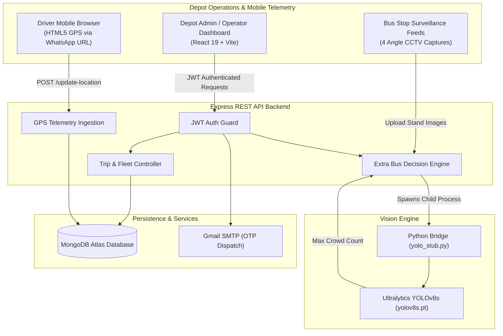
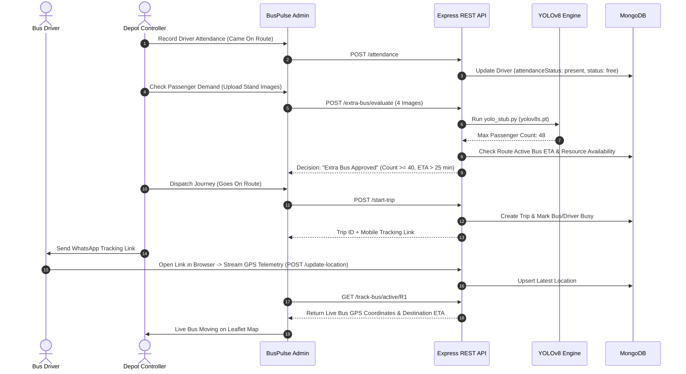

# 🚍 BusPulse

> **Automated Passenger Demand Analysis & Dynamic Bus Resource Allocation System**

[](LICENSE)
[](https://nodejs.org/)
[](https://react.dev/)
[](https://docs.ultralytics.com/)
[](https://tailwindcss.com/)
[](https://www.mongodb.com/)

---

## 📌 1. Project Overview

**BusPulse** is an intelligent public transport management platform designed to eliminate passenger congestion and optimize fleet utilization. Rather than operating municipal buses on rigid, static timetables, BusPulse dynamically assesses passenger crowd density at major transit hubs and calculates whether supplementary buses should be dispatched in real time.

The system pairs **computer vision (Ultralytics YOLOv8)** at bus stands with **lightweight mobile GPS telemetry transmitted via WhatsApp links**, giving transit depot controllers a single operational command center to manage attendance, dispatch vehicles, monitor live routes on an interactive map, and make data-driven dispatch decisions.

> [!NOTE]
> **Internal Operational System**: BusPulse is a specialized Business-to-Employee (B2E) administrative command center used exclusively by depot operators, controllers, and drivers. There is no customer-facing ticketing app; all views serve fleet logistics and depot workflow.

---

## ❓ 2. Problem Statement

Conventional public transport systems suffer from critical scheduling mismatches:
- **Static Fleet Allocation**: Buses run on fixed time intervals regardless of unpredictable surges during rush hours, festivals, or train arrivals.
- **Congestion & Long Waiting Times**: Commuters experience severe delays at high-density bus stands while buses on less congested routes run near empty.
- **Driver & Vehicle Friction**: Native driver mobile applications introduce high onboarding friction, complex installation barriers, and battery-draining background processes.
- **Depot Operational Blindspots**: Dispatchers frequently lack instant visibility into driver shift readiness, vehicle availability, and actual road transit ETAs.

**BusPulse solves this by combining live camera crowd analysis, intelligent multi-condition dispatch matrices, and low-friction browser-based GPS tracking.**

---

## ✨ 3. Core Features

- 👤 **Operator Authentication & Security**:
  - Secure registration with email OTP verification delivered via Nodemailer SMTP.
  - Role-based access control with stateless JSON Web Tokens (JWT) and Bcrypt password hashing.

- 👥 **Depot-Wide Driver Attendance & Roster**:
  - Daily check-in (`Came on Route`) and check-out (`Check Out`) workflows.
  - Quick multi-field search (by driver name, pilot status, or phone number).
  - Depot-wide availability queries tracking `present` vs. `absent` and `free` vs. `busy`.

- 🚌 **Fleet & Depot Bus Management**:
  - Full CRUD registry for depot buses with route assignments.
  - Active trip safety locks preventing accidental modification or deletion of buses currently in transit.
  - Non-destructive soft deletion preserving historical trip references.

- 🚀 **Trip Dispatch & Frictionless WhatsApp Tracking**:
  - Dispatch workflows pairing available buses with checked-in drivers.
  - Automatic generation of unique trip tracking URLs with QR codes.
  - One-click WhatsApp message generation (`https://wa.me/?text=...`) sending tracking links directly to the driver's phone without requiring any mobile app installation.

- 🗺️ **Live GPS Telemetry & Destination ETA**:
  - Mobile browser GPS geolocation streaming (`watchPosition`) to backend endpoints.
  - Real-time Leaflet map rendering bus progress along defined route waypoints.
  - Real-time road distance and speed calculation estimating destination arrival time.

- 🤖 **YOLOv8 Passenger Demand Analysis & Decision Matrix**:
  - Multi-angle camera capture upload (up to 4 viewpoints) analyzing bus stop crowd density.
  - Automated person detection using Ultralytics YOLOv8s (`cls=0`) returning peak crowd density.
  - Automated decision matrix evaluating passenger volume ($\ge 40$), current bus ETA ($> 25\text{ min}$), and resource availability before recommending extra bus dispatches.

- 📊 **Operational Audit & Journey Reporting**:
  - Complete history of completed and active trips with departure and arrival timestamps.
  - Automatic state reconciliation resolving orphaned busy resources.

---

## 🛠️ 4. Technology Stack

| Layer | Technologies |
| :--- | :--- |
| **Frontend UI** | React 19, Vite 8, Tailwind CSS, Lucide React, Axios |
| **Interactive Mapping** | Leaflet, React Leaflet |
| **Backend REST API** | Node.js, Express 4, Mongoose (MongoDB) |
| **Authentication** | JSON Web Tokens (`jsonwebtoken`), Bcrypt (`bcryptjs`), Nodemailer SMTP |
| **Computer Vision** | Python 3, Ultralytics YOLOv8 (`yolov8s.pt`), OpenCV (`cv2`), NumPy |
| **Driver Telemetry** | HTML5 Geolocation API, WhatsApp Click-to-Chat API |
| **Database** | MongoDB Atlas / Local MongoDB instance |

---

## 🏛️ 5. System Architecture



For full architectural blueprints, entity-relationship diagrams, and route specifications, see [docs/ARCHITECTURE.md](docs/ARCHITECTURE.md).

---

## 🔄 6. Project Workflow



---

## 📁 7. Repository Structure

```
BusPulse/
├── backend/                      # Node.js Express REST API & ML engine
│   ├── src/
│   │   ├── config/               # Database connection
│   │   ├── controllers/          # Business logic & request handlers
│   │   ├── middleware/           # JWT auth middleware
│   │   ├── models/               # Mongoose data schemas
│   │   ├── routes/               # Express API route endpoints
│   │   ├── utils/                # Route coordinates, email service, network helpers
│   │   ├── index.js              # Application entrypoint
│   │   └── update_db.js          # Standalone DB update script
│   ├── ml/                       # YOLOv8 passenger detection model & wrapper
│   │   ├── yolo_stub.py          # Python detection CLI wrapper
│   │   ├── yolov8s.pt            # Pre-trained YOLOv8s model weights
│   │   └── yolo_cache.pkl        # Model cache
│   ├── scripts/                  # Data reconciliation & diagnostic scripts
│   ├── tests/                    # Automated integration & lifecycle test suites
│   ├── .env                      # Local backend environment variables (gitignored)
│   ├── .env.example              # Safe backend environment variable template
│   ├── .gitignore                # Backend-specific ignore rules
│   ├── package.json              # Backend package manifest
│   └── package-lock.json         # Backend lockfile
├── frontend/                     # React 19 + Vite admin dashboard
│   ├── public/                   # Static icons & favicons
│   ├── src/
│   │   ├── assets/               # Branding graphics & vector assets
│   │   ├── components/           # Navigation bars & route guards
│   │   ├── context/              # Auth state context
│   │   ├── pages/                # Admin views (Attendance, Dispatch, Tracking, YOLO)
│   │   ├── utils/                # Route helpers & WhatsApp encoder
│   │   ├── App.jsx               # Application routes
│   │   ├── index.css             # Tailwind base styles
│   │   └── main.jsx              # DOM entrypoint
│   ├── .env                      # Local frontend environment variables (gitignored)
│   ├── .env.example              # Safe frontend environment variable template
│   ├── .gitignore                # Frontend-specific ignore rules
│   ├── package.json              # Frontend package manifest
│   ├── tailwind.config.js        # Tailwind CSS config
│   └── vite.config.js            # Vite bundler config
├── docs/                         # Comprehensive project documentation
│   ├── ARCHITECTURE.md           # System design & data models
│   ├── PROJECT_STRUCTURE.md      # Detailed repository layout
│   └── SETUP_GUIDE.md            # Detailed setup instructions
├── .gitignore                    # Root gitignore excluding secrets & build outputs
├── LICENSE                       # MIT Open Source License
├── README.md                     # Main project presentation (this file)
└── TODO.md                       # Pending task tracker
```

For a comprehensive line-by-line description of all files, see [docs/PROJECT_STRUCTURE.md](docs/PROJECT_STRUCTURE.md).

---

## ⚙️ 8. Installation & Setup

### Prerequisites
- **Node.js** v18+ & **npm**
- **Python** 3.10+
- **MongoDB** (Cloud Atlas or local instance)

### 8.1 Backend Setup
```bash
cd backend
npm install
cp .env.example .env
```
Configure `backend/.env` with your MongoDB URI, JWT secret, and optional Gmail SMTP credentials:
```env
PORT=5000
MONGO_URI=mongodb+srv://<username>:<password>@cluster.mongodb.net/buspulse
FRONTEND_URL=http://localhost:5173
PUBLIC_TRACKING_URL=http://localhost:5173
NODE_ENV=development
JWT_SECRET=your_secret_key_here
JWT_EXPIRES_IN=1h
```

### 8.2 Python Machine Learning Setup
```bash
# Inside backend/ (or in backend/ml/)
python -m venv venv

# Windows
venv\Scripts\activate
# Linux/macOS
source venv/bin/activate

pip install ultralytics opencv-python numpy
```
*Note: Verify that `backend/ml/yolov8s.pt` (22.5 MB) is present in the repository.*

### 8.3 Frontend Setup
```bash
cd ../frontend
npm install
cp .env.example .env
```
Configure `frontend/.env`:
```env
VITE_PUBLIC_TRACKING_URL=http://localhost:5173
VITE_API_URL=http://localhost:5000
```

---

## 🚀 9. Execution Commands

### Run Backend Server
```bash
cd backend
npm run dev
# Server starts at http://localhost:5000
```

### Run Frontend Development Server
```bash
cd frontend
npm run dev
# UI accessible at http://localhost:5173
```

### Build Frontend for Production
```bash
cd frontend
npm run build
```

### Run Integration Test Suites
```bash
cd backend
node tests/test_depot_bus_management.js
node tests/test_complete_lifecycle.js
node tests/test_updated_features.js
node tests/test_auth_and_regression.js
```

---

## 🖼️ 10. Application Screenshots

### 10.1 Operator Admin Dashboard
Overview of fleet metrics, available buses, present drivers, and live route status.


### 10.2 Driver Attendance & Shift Management
Depot-wide driver roster allowing operators to mark attendance (`Came on Route`) and search by name/pilot ID.


### 10.3 Journey Dispatch (`Goes on Route`) & WhatsApp Link Generation
Dispatching a vehicle and generating dynamic mobile tracking links shareable via WhatsApp.


### 10.4 Real-Time Map Tracking & Destination ETA
Live Leaflet interactive map displaying active bus location, speed, and real-time destination ETA.


### 10.5 YOLOv8 Multi-Angle Crowd Detection
Analyzing 4 camera feeds from bus stops using YOLOv8 to estimate passenger crowd density.


### 10.6 Dynamic Extra Bus Decision Matrix Result
System evaluation displaying whether an extra bus is approved or not justified based on ETA and crowd size.


### 10.7 Operational History & Journey Reporting
Comprehensive audit logs tracking completed trips, departure/arrival timestamps, and vehicle allocation.


---

## 🔮 11. Future Scope

- **Edge AI Integration**: Deploy lightweight YOLO models directly on edge camera hardware (e.g., Raspberry Pi or NVIDIA Jetson) to reduce image upload bandwidth.
- **Predictive Demand Forecasting**: Incorporate time-series forecasting (LSTM / Prophet) to proactively anticipate passenger spikes based on weather, holidays, and railway arrivals.
- **Passenger Information Displays (PIDS)**: Real-time public arrival display integration for bus stops via WebSockets or MQTT.
- **Automated Driver Notification Bot**: Direct integration with WhatsApp Business API to deliver automated dispatch notifications and turn-by-turn alerts.

---

## 👨‍💻 12. Contributors

- **Bhushan Kamble** ([@bhushan7278](https://github.com/bhushan7278)) – *Lead Architect & Full Stack Developer*

---

## 📄 13. License

This project is licensed under the **MIT License**. See the [LICENSE](LICENSE) file for complete details.
