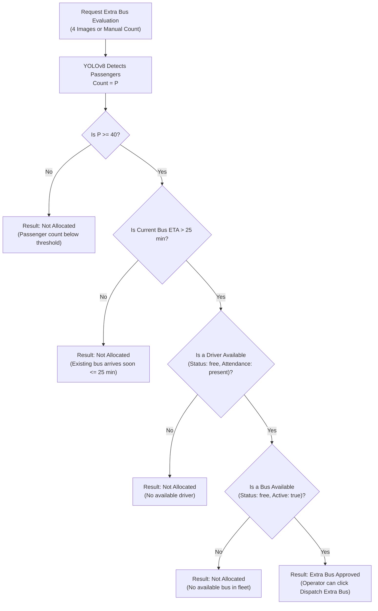
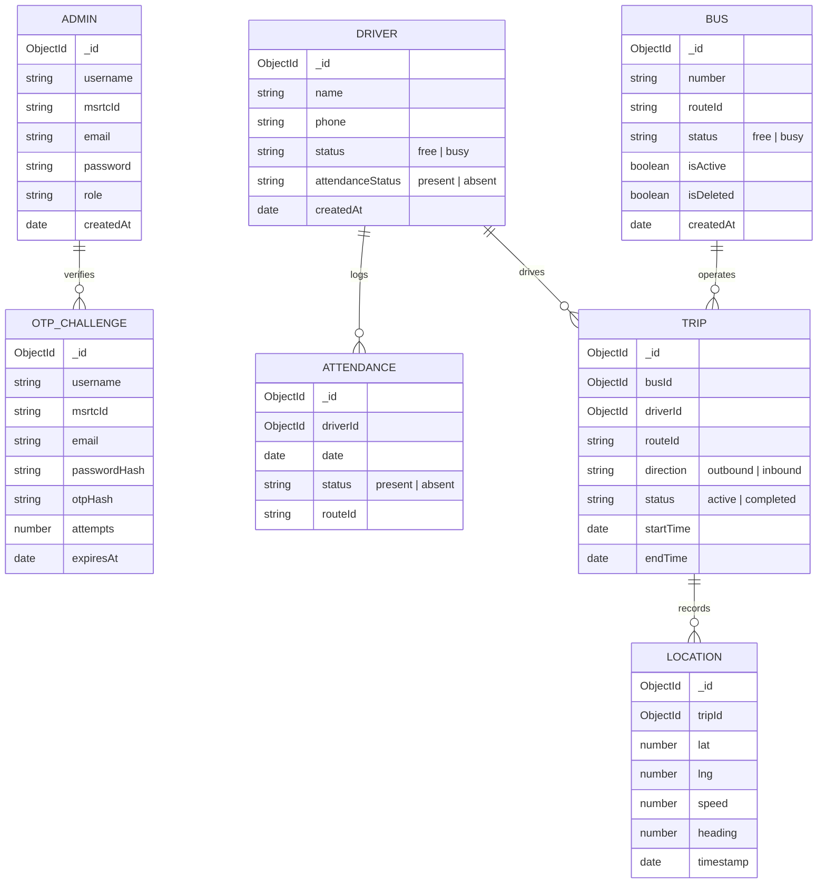

# BusPulse – System Architecture Documentation

This document describes the technical architecture, data flows, subsystem designs, and decision algorithms powering **BusPulse**, an automated passenger demand analysis and dynamic bus resource allocation system.

---

## 1. High-Level Architecture

BusPulse connects three primary operational surfaces:
1. **Operator Admin Panel (Web Application)**: Single internal interface for depot administrators to dispatch trips, record attendance, track buses on an interactive Leaflet map, and review passenger demand.
2. **REST API & Computer Vision Engine (Express + YOLOv8)**: Central controller handling data persistence, authentication, GPS telemetry updates, and automated image-based crowd estimation.
3. **Driver Mobile Tracking Interface (Web Client)**: Minimalist GPS transmitter accessed via a WhatsApp link on the driver's phone, transmitting periodic coordinates without requiring a native mobile app install.

```mermaid
flowchart TD
    subgraph ClientLayer["Client & Operational Layer"]
        AdminUI["Admin & Operator Dashboard<br/>(React 19 + Vite + Tailwind)"]
        DriverPhone["Driver Smartphone<br/>(Web GPS Tracker via WhatsApp link)"]
        CameraFeed["Bus Stop CCTV / Cameras<br/>(4 Angle Image Captures)"]
    end

    subgraph ServerLayer["Backend Application Layer (Node.js Express)"]
        Router["Express REST API Router"]
        AuthMid["JWT Auth Middleware"]
        Controllers["Controllers<br/>(Bus, Driver, Trip, Location, ExtraBus)"]
        MLBridge["Python Child Process Bridge<br/>(yolo_stub.py)"]
    end

    subgraph MLLayer["Computer Vision Subsystem"]
        YOLO["Ultralytics YOLOv8s<br/>(yolov8s.pt Weights)"]
        CV2["OpenCV Image Decoder"]
    end

    subgraph DataLayer["Data & Persistence Layer"]
        MongoDB[("MongoDB Database<br/>(Mongoose ORM)")]
        SMTP["Gmail SMTP Transport<br/>(Nodemailer OTP Dispatch)"]
    end

    AdminUI -->|REST API / JWT| Router
    DriverPhone -->|POST /update-location| Router
    CameraFeed -->|Multipart Form Data (4 Images)| Router

    Router --> AuthMid
    AuthMid --> Controllers

    Controllers -->|Executes Child Process| MLBridge
    MLBridge --> CV2
    CV2 --> YOLO
    YOLO -->|Max Crowd Count| MLBridge
    MLBridge -->|JSON Result| Controllers

    Controllers -->|Read / Write| MongoDB
    Controllers -->|Send OTP Email| SMTP
```

---

## 2. Subsystem Breakdown

### 2.1 Operator Web Application (`frontend/`)
The frontend is built with **React 19** and bundled with **Vite**.
- **State Management**: React `useState`, `useEffect`, and custom React context (`AuthContext`) managing JWT lifecycle and operator credentials.
- **Routing**: `react-router-dom` v6 with `ProtectedRoute` guarding all operational panels from unauthenticated access.
- **Mapping & Telemetry**: `leaflet` and `react-leaflet` rendering live routes, stops, and moving bus markers based on real-time GPS telemetry from MongoDB.
- **Icons & Styling**: `lucide-react` for UI icons and `tailwindcss` for high-density, accessible layout design.

### 2.2 Backend REST API (`backend/src/`)
Structured following the **Model-View-Controller (MVC)** design pattern:
- **Routes (`/src/routes/`)**: Map incoming HTTP requests to controller methods.
  - `/auth`: Registration, OTP challenge verification, login, profile check.
  - `/buses`: Depot bus inventory, status queries (`free`, `busy`), soft deletion.
  - `/drivers`: Driver profiles, search, attendance check-in, and check-out.
  - `/trips`: Trip dispatch (`/start-trip`), live trip monitoring (`/trips/active`), trip completion (`/trips/complete`), and state reconciliation.
  - `/update-location` & `/get-location`: High-frequency GPS telemetry ingestion and retrieval.
  - `/extra-bus/evaluate`: Crowd analysis and extra bus allocation engine.
- **Controllers (`/src/controllers/`)**: Business logic enforcing atomic database transactions and strict resource state transitions (`free` <-> `busy`).
- **Middleware (`/src/middleware/`)**: `authMiddleware.js` verifies the incoming `Authorization: Bearer <token>` header using `jsonwebtoken`.

### 2.3 Computer Vision Subsystem (`backend/ml/`)
Automated passenger counting is powered by **Ultralytics YOLOv8s**:
1. When evaluating passenger demand, up to 4 images capturing different angles of a bus stand are uploaded.
2. The Node.js controller executes `yolo_stub.py` via `child_process.spawn`.
3. The script decodes each image buffer using `OpenCV (cv2.imdecode)`.
4. Inference runs using `yolov8s.pt` to detect objects belonging to `class 0` (person).
5. The script calculates the **maximum count** observed across all camera angles (avoiding double-counting while capturing peak crowd density) and returns it to the Node.js process.

### 2.4 Dynamic Extra Bus Decision Matrix
The extra bus evaluation algorithm uses a multi-factor decision matrix:

$$\text{Decision} = \begin{cases} \text{Approved}, & \text{if } P \ge T_p \land \text{ETA} > T_\text{eta} \land B_\text{avail} \land D_\text{avail} \\ \text{Not Allocated}, & \text{otherwise} \end{cases}$$

Where:
- $P$: Detected passenger count (from YOLOv8) or operator manual count override.
- $T_p$: Passenger threshold (configured to **40 passengers**).
- $\text{ETA}$: Estimated time of arrival of the current active scheduled bus to the destination stand.
- $T_\text{eta}$: ETA threshold (configured to **25 minutes**). If the next bus is already $\le 25\text{ min}$ away, an extra bus is not justified.
- $B_\text{avail}$: Presence of at least one `free` bus in the depot fleet.
- $D_\text{avail}$: Presence of at least one `free` and `present` driver on shift.



### 2.5 Real-Time GPS Tracking & WhatsApp Integration
To eliminate the friction of installing native mobile applications on driver devices:
1. When a journey is dispatched via `POST /start-trip`, the system generates a tracking URL containing the `tripId`:
   `http://<SERVER_IP>:5173/track?tripId=<TRIP_ID>`
2. The operator clicks "Share via WhatsApp" which generates a pre-filled WhatsApp Web/Mobile link (`https://wa.me/?text=...`) to message the assigned driver.
3. The driver opens the link on their mobile browser. The browser requests `navigator.geolocation.watchPosition()`.
4. High-accuracy coordinates are posted every 5-10 seconds to `POST /update-location`.
5. The depot tracking view (`TrackBus.jsx`) continuously polls active coordinates, projects the bus on a map along predefined waypoints (`src/utils/routeConfig.js`), computes remaining distance using Haversine calculation, and determines the arrival ETA.

---

## 3. Data Architecture & Schema Models



---

## 4. Security & Compliance Design

1. **Password Hashing**: Passwords are encrypted using `bcryptjs` with salt work factor of 10.
2. **Email OTP Verification**: Registration requires completing an out-of-band email OTP challenge sent via SMTP before credentials are saved to `Admin`.
3. **Stateless JWT**: Sessions use JSON Web Tokens with a 1-hour expiration. Protected endpoints validate bearer tokens through `authMiddleware.js`.
4. **Soft Deletions**: Buses and drivers maintain historical integrity by utilizing `isDeleted: true` flags, preventing orphaned references in completed trips.
5. **Secrets Isolation**: Actual `.env` files are strictly excluded from source control, accompanied by well-documented `.env.example` templates.
